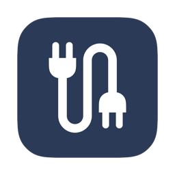
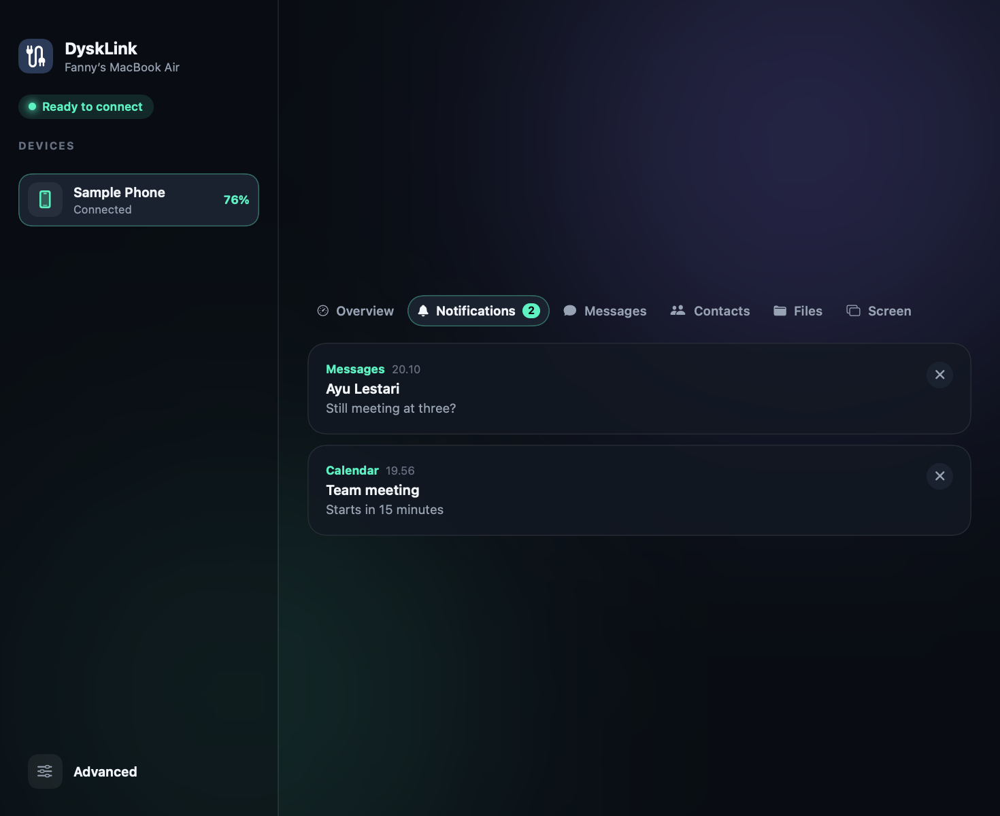
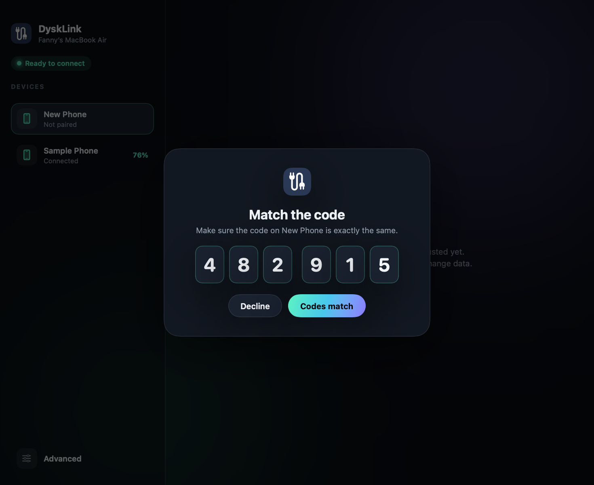
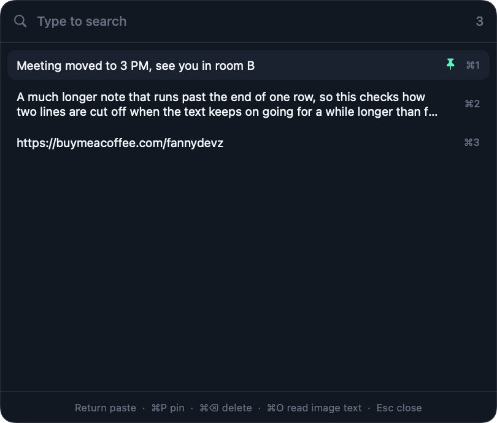
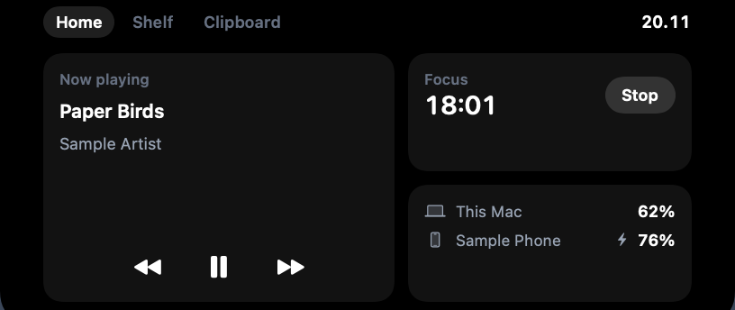
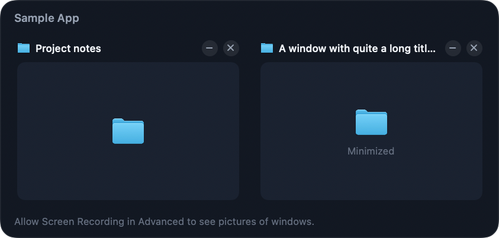

<p align="center">
  
</p>

<h1 align="center">DyskLink for Mac</h1>

<p align="center">Connects your Mac and Android phone over local Wi-Fi, with no cloud and no account.</p>

<p align="center">
  <a href="https://github.com/DyskLab/dysklink-mac/releases/latest"></a>
  <a href="LICENSE"></a>
  <a href="https://www.fanny.dev/dysklab"></a>
  <a href="https://buymeacoffee.com/fannydevz"></a>
</p>



DyskLink also adds a set of optional tools to the Mac, each off until you turn it on.

**This is the Mac app. The phone app is [DyskLink for Android](https://github.com/DyskLab/dysklink-android).**
You need both to use the phone features. The Advanced tools work on the Mac alone.

> DyskLink is in early development, so expect rough edges.

## Download
You need macOS 15 or later on Apple Silicon.

1. Download `DyskLink-mac-arm64.zip` from the [latest release](https://github.com/DyskLab/dysklink-mac/releases/latest),
   unzip it, and move **DyskLink** to Applications.
2. The app isn't notarized, so macOS blocks the first launch. Open **System Settings > Privacy & Security** and choose
   **Open Anyway**.
3. [Install the Android app](https://github.com/DyskLab/dysklink-android#download) and open it on the same network.

This download has an ad-hoc signature, so macOS asks for Accessibility again after you install a newer version. To
avoid that, or to run on Intel, [build it from source](#build-and-run).

| Pairing | Clipboard History |
| --- | --- |
|  |  |
| **Notch** | **Window Previews** |
|  |  |

## With your phone
- **Connection:** encrypted pairing, multiple devices, automatic reconnection, and phone status such as battery,
  storage, and signal.
- **Files:** send files both ways. Files from the phone go to Downloads/DyskLink.
- **Clipboard:** copies on the Mac go to the phone, and the phone can send its copies back.
- **Remote control:** use the phone as a touchpad, keyboard, media remote, or presentation remote, and run Mac
  commands you've listed in advance.
- **Phone data:** notifications, SMS, call alerts, contacts with vCard export, and read-only access to phone files.
- **Screen:** see the phone's screen on the Mac and control it with your mouse and keyboard.

Phone data, screen, and control are off until you turn them on from the phone. The Mac keeps phone data in memory
only. It's cleared when a feature is turned off or the devices unpair. Contacts reach the disk only if you press
Export vCard, and downloaded files go to Downloads/DyskLink.

## Advanced tools
Open **Advanced** at the bottom of the sidebar. **Open at login** at the top of the page starts DyskLink in the
menu bar when you log in. If you move the app afterward, turn it off and on again.

- **System Monitor:** CPU, memory, disk, network, battery, and the busiest apps. It only samples while the page
  is on screen.
- **Keep Awake:** keeps the Mac or its screen awake for a set time or until you stop it, optionally only while
  plugged in, until the battery falls below a limit, or until there's been no activity for a time you choose. It
  holds a macOS power assertion and changes no settings.
- **Clipboard History:** **Control + Command + V** shows what you copied, and Return pastes it.
  **Control + Command + O** copies the text in part of the screen, and both shortcuts can be changed. Items stay in
  Application Support on this Mac, readable only by your account, up to 200 items and 30 images plus anything
  pinned. Content marked private or temporary is always skipped. **Ignore passwords**, on by default, also skips
  copies from password apps and one-word text that mixes letters, numbers, and symbols. A plain word used as a
  password can still be saved, and some codes can be skipped by mistake.
- **Brightness and Volume:** sliders on the page and in the menu bar for the built-in screen, external monitors,
  and the sound output, with one slider for all screens. The brightness keys can control every screen too. Monitors
  are controlled over DDC/CI, and a monitor that doesn't answer has its picture dimmed instead. **Allow darker** lets
  the bottom quarter of the slider darken the picture below the backlight's minimum.
- **Mouse:** turns off pointer acceleration, sets pointer speed, reverses the wheel, or scrolls a fixed distance
  per notch, for external mice only. Command, Shift, Option, Control, and Option + Control with the wheel can each
  scroll sideways, faster, or slower, zoom, or change volume or brightness. Settings go back when you turn this off
  or quit, and after a crash they go back when the mouse reconnects or the Mac restarts.
- **Window Previews:** point at a Dock icon to see that app's windows, then click to focus, minimize, or close one.
  **Option + Tab** switches between windows. It lists windows on the current Space and minimized windows. To catch
  this shortcut, the app checks which key each press is, without storing or sending it.
- **Notch:** point at or click the top of the built-in screen, or a thin bar on the main screen with the lid closed,
  for music controls, a 25-minute focus timer, Mac and phone batteries, a file shelf, and recent copies. Song titles
  come from Music and Spotify only, while the buttons control whichever player is active. The shelf only remembers
  where files are. On a screen with a camera, the panel's menu starts below it. On a screen with no camera, the
  closed bar is hidden unless you turn off **Hide the bar on screens without a camera**. **Fit more icons beside the
  camera** brings menu bar icons closer together after you log out and back in, without changing the screen size.

Brightness, Mouse, and Window Previews use private Apple APIs looked up at run time, so a macOS update could
disable them.

## Permissions
- **Accessibility:** for the touchpad, keyboard, and remotes from the phone, pasting from Clipboard History, Mouse
  wheel options (which only look at scroll events), and Window Previews.
- **Screen Recording:** for reading text from the screen and for window pictures in Window Previews.
- **Notifications:** requested the first time the notification, SMS, or call feature turns on.

Builds signed with the certificate below keep the Accessibility grant across rebuilds. An ad-hoc build loses the
grant with every build, even though the switch still looks on in Settings. To redo it, press **Allow** in the app,
then turn DyskLink on in Settings.

## Build and run
You need macOS 15 or later. The Command Line Tools are enough.

```bash
git clone https://github.com/DyskLab/dysklink-mac.git
cd dysklink-mac
```

Create the signing certificate once per Mac:
```bash
./scripts/create-signing-cert.sh
```

The first build that uses it shows a Keychain dialog. Enter your own login password and choose **Always Allow**.
```bash
./scripts/bundle.sh
open dist/DyskLink.app
```

To remove the certificate:
```bash
security delete-identity -c "DyskLink Local Signing"
```

When the window closes, the app keeps running from the cable icon in the menu bar. That menu has
**Open at login** and **Quit**.

Then [install the Android app](https://github.com/DyskLab/dysklink-android#build-and-install) and open it on the same
network. A new Mac brings up the code screen right away. Compare the code and confirm on both devices. After that,
connecting is automatic.

## Tests
The integration test runs the Android core against the debug Mac app over real TLS, with a separate port, folders,
and clipboard, and without injecting input. It needs JDK 17, the Android SDK, and
[dysklink-android](https://github.com/DyskLab/dysklink-android) cloned next to this repository, or its location in
`DYSKLINK_ANDROID_DIR`.

```bash
./scripts/integration-test.sh
```

Phone data in this test is fake. The video decoder is tested with H.264 made by VideoToolbox, not with phone encoder
output.

## Development
Debug builds support:
- `PhoneLinkMac --snapshot <folder>`: renders PNGs of the main screens.
- `PhoneLinkMac --render-icon <file.png>`: renders the 1024x1024 app icon source.
- `PhoneLinkMac --video-selftest`: tests the video decoder.
- `PhoneLinkMac --tools-selftest`: tests the Advanced tools.
- `PHONELINK_DATA_DIR=<folder>`: uses a separate data folder.
- `PHONELINK_TEST_AUTO_ACCEPT=1`: accepts pairing automatically, for testing only.
- `PHONELINK_PORT`, `PHONELINK_DOWNLOAD_DIR`, `PHONELINK_TEST_DRY_RUN=1`, `PHONELINK_TEST_SEND_FILE`, and
  `PHONELINK_TEST_PROBE_PHONE=1`: used by the integration test script.

None of these exist in release builds.

Both apps speak the protocol in [docs/PROTOCOL.md](docs/PROTOCOL.md). A change to it needs a matching change in
[dysklink-android](https://github.com/DyskLab/dysklink-android).

## Current security limits
Private keys are stored as files with restricted permissions in the app data folder, not yet in the Keychain.

## Internal names
The app's display name is DyskLink. The old name PhoneLink remains in the bundle ID, the `_phonelink._tcp` network
service, the Swift target, and the data folder, because changing them would erase existing pairings.

## Support
DyskLink is free and open source under the [MIT License](LICENSE). If it helps you, you can
[buy me a coffee](https://buymeacoffee.com/fannydevz).

## Part of DyskLab
DyskLink is part of [DyskLab](https://www.fanny.dev/dysklab), alongside
[DyskFlow](https://github.com/DyskLab/dyskflow), [DyskFiles](https://github.com/DyskLab/dyskfiles), and
[DyskFocus](https://github.com/DyskLab/dyskfocus).
